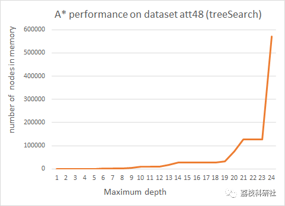
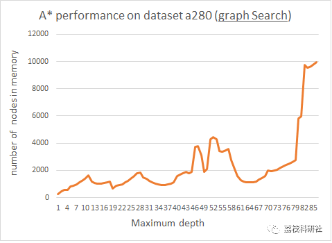
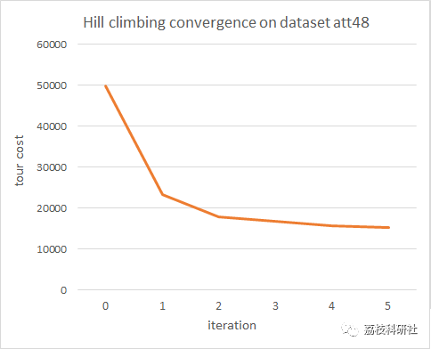
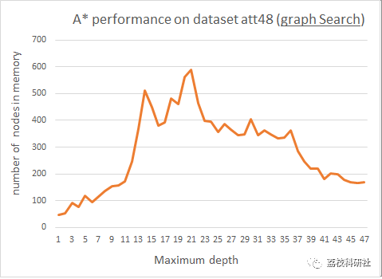
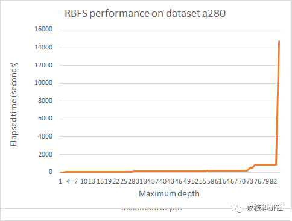

# Solution to TSP Problem Based on A*, RBFS and Hill Climbing Algorithm (Matlab Code)

[Please wait for a longer period of time before the operation is completed.][Warm Reminder]
Switching files:
% Read the TSP graph from xml file and convert it to matlab graph object
💥💥💥💞💞💞💞 Welcome to this blog❤️❤️❤️💥💥💥
🏆 Bloggers' Advantage: 🌞🌞🌞 The content of the blog strives to be rigorous in thought and clear in logic, for the convenience of readers.
⛳️ Mantra: The journey of a hundred miles is half done in the last ninety.
Litchi Research Society
Code Collection: Power System, Intelligent Algorithms and Applications, Neural Network Prediction, Path Planning, Optimized Scheduling, Workshop Scheduling, Image Processing, Signal Processing...
🎁Column Directory Link:
🌈🌈🌈🌟🌟🌟Electrical Code Intelligent Algorithm and Its Application Path Planning Neural Network Predictive Optimization Scheduling Image Processing Workshop Scheduling Signal Processing Romantic Her My Philosophical Thoughts Math Modeling Complete Code Matters
💥1 Overview
📚2 Running Results
🎉3 References
🌈4 Matlab code and detailed article
💥1 Overview
The TSP (Traveling Salesman Problem) is a well-known problem in the field of mathematics, which is essentially a typical NP-complete problem. As the scale of computation gradually increases, the computational load will grow exponentially, and it can be widely applied to applications involving path planning. Given an undirected complete graph G=(V.E.r), traversing all vertices to form a closed loop such that the sum of edge weights on the loop is minimized, where V=[1,2,...n] represents the visited cities, E is the set of edges between different vertices in V, and r is the set of edge weights. The mathematical model is as follows:

Formula (1) is the objective function, which is the minimization of the path length in the TSP problem, where d represents the weight between two cities. Formulas (2) and (3) represent that each city is visited only once by the traveling salesman. Formula (4) indicates that the traveling salesman cannot form a cycle in any subset of cities, and formula (5) represents the decision variables, where 1 indicates that the city has been visited, and 0 indicates that it has not been visited. Therefore, from the above description, it can be seen that solving this type of problem using bioinspiration algorithms has a good effect.

📚2 Run Results
🎉3 References
[1] Hamdi Altaheri (2022). Solving TSP using A star, RBFS, and Hill-climbing algorithms

🌈4 Matlab Code and Detailed Article

## Images

<!-- PAYMENT_BLOCK -->

## Get this dataset

- Payment link (Stripe): [Buy now](https://buy.stripe.com/3cs8yP7sY87d0vu9AB)
- Payment QR code: 

<!-- /PAYMENT_BLOCK -->
